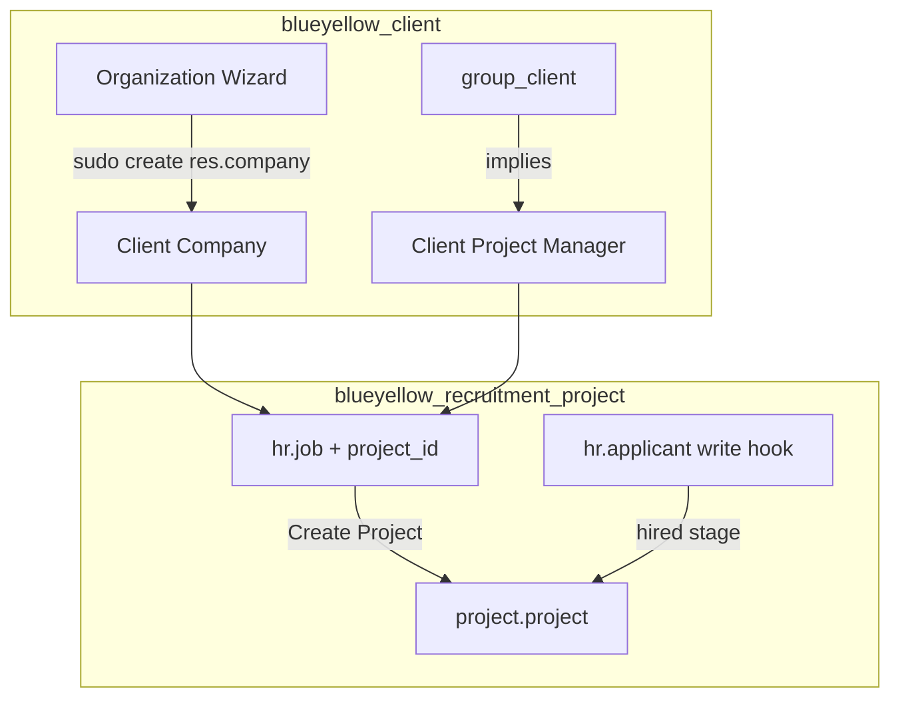

# BlueYellow platform addons — detailed spec

Two small addons under `addons/`. No core patches. Inherit models, add wizards, security, and views only.

---

## Scope summary

| Module | Responsibility | Out of scope |
|--------|----------------|--------------|
| **`blueyellow_client`** | Client role, self-service **organization** creation, company ownership rules, **company-scoped projects** | Consultant profiles, payments, recruitment |
| **`blueyellow_recruitment_project`** | Link **job ↔ project**, create project from job, **on hire** link consultant to project | Company wizard, theme, invoicing |

Optional later: merge into one module if preferred; keep separate for minimal boundaries.

---

## Module 1: `blueyellow_client`

### Purpose

Allow **Client** users to create additional organizations (`res.company`) without Settings access, and see the **company switcher** once they have two or more allowed companies.

### Dependencies

```python
"depends": ["base", "hr_recruitment", "project", "account"],
```

(`hr_recruitment` / `project` / `account` only so we can imply their standard client groups in one place.)

### File tree

```text
addons/blueyellow_client/
├── __init__.py
├── __manifest__.py
├── hooks.py                      # post-init + migration user cleanup
├── migrations/
│   ├── 1.0.1/post-migrate.py
│   ├── 1.0.2/post-migrate.py
│   └── 1.0.4/post-migrate.py
├── models/
│   ├── __init__.py
│   ├── res_company.py            # inherit: owner field
│   ├── res_users.py              # guard Client vs Project Administrator overlap
│   ├── project_project.py        # company defaults + client search filter
│   └── project_task.py           # client search filter
├── wizard/
│   ├── __init__.py
│   ├── client_organization_wizard.py
│   └── client_organization_wizard_views.xml
├── security/
│   ├── blueyellow_client_security.xml
│   └── ir.model.access.csv
├── views/
│   └── res_company_views.xml
├── demo/
│   ├── res_company_demo.xml      # Client Co.
│   └── res_users_demo.xml        # Client Manager (demo/demo)
└── data/
    └── menu.xml
```

---

### Security groups

**`blueyellow_client.group_client`** — **Client**

Implies:

| XML id | Purpose |
|--------|---------|
| `base.group_user` | Internal user |
| `base.group_multi_company` | Company switcher (visible once user has 2+ allowed companies) |
| `hr_recruitment.group_hr_recruitment_user` | Post jobs, manage applicants |
| `blueyellow_client.group_client_project` | Create/edit projects (company-scoped) |
| `account.group_account_invoice` | Billing / invoices |
| `hr_timesheet.group_hr_timesheet_approver` | Approve timesheets |

**`blueyellow_client.group_client_project`** — **Client Project Manager**

Implies `project.group_project_user` only. Grants create/write on `project.project` via `ir.model.access.csv`.

**Does not imply** `project.group_project_manager`. That standard group adds a “see all projects” record rule and must not be assigned to clients.

**Does not imply:** `base.group_system`, `group_erp_manager`.

**Home menu (app tiles):** Client users do not see root apps **Website**, **Employees**, **Expenses**, or **Apps**. Implemented via `models/ir_ui_menu.py` (`_visible_menu_ids` + `_load_menus_blacklist`).

**Dependencies:**

```python
"depends": ["base", "hr_recruitment", "project", "account", "hr_timesheet"],
```

---

### Model extension: `res.company`

**File:** `models/res_company.py`

```python
class ResCompany(models.Model):
    _inherit = "res.company"

    blueyellow_owner_id = fields.Many2one(
        "res.users",
        string="Created by",
        index=True,
        copy=False,
        help="Client user who created this organization via the BlueYellow wizard.",
    )
```

No override of `create()` on the model — creation goes through the wizard with `sudo()` so we do not fight core `res.company.create` side effects.

---

### Wizard: `client.organization.wizard`

**File:** `wizard/client_organization_wizard.py`

**Fields:**

| Field | Type | Required | Notes |
|-------|------|----------|-------|
| `name` | Char | yes | Organization display name |
| `email` | Char | no | Stored on company partner |
| `phone` | Char | no | Stored on company partner |
| `country_id` | Many2one `res.country` | no | |
| `parent_id` | Many2one `res.company` | yes, default | Platform company (first root company, or `env.company` if user is on platform) |

**Access:** only users in `blueyellow_client.group_client`.

**Method:** `action_create_organization`

Pseudocode:

```python
def action_create_organization(self):
    self.ensure_one()
    platform = self._get_platform_company()  # env.ref or search parent_id=False limit 1
    company = self.env["res.company"].sudo().create({...})

    owned_companies = self.env["res.company"].sudo().search([
        ("blueyellow_owner_id", "=", self.env.user.id),
    ])
    self.env.user.sudo().write({
        "company_ids": [(6, 0, owned_companies.ids)],
        "company_id": company.id,
    })
```

After creation, the user's **allowed companies are only organizations they own** (the platform company is removed). The company switcher appears once they own two or more organizations.

**Validation:**

- `name` stripped, min length 2
- No duplicate `name` among companies where `blueyellow_owner_id = user` (or global duplicate — product choice: **per-owner uniqueness** only for v1)
- User must be in `group_client`

**Platform company resolution (`_get_platform_company`):**

1. Company with `parent_id` = False, lowest id (BlueYellow / YourCompany)
2. Document in README that admin should keep exactly one root platform company

---

### Project company scoping

Clients must not see platform, demo, or other tenants' projects. Standard Flectra **Project Administrator** is unsuitable for clients because it includes a global “see all” rule and because `base.group_user` follower rules OR-combine with company rules.

**`models/project_project.py` and `models/project_task.py`:**

- **`default_get` / `create`** — when user has **Client** group, set `company_id` and `partner_id` from `env.company` if omitted (fixes Projects app creating company-less records).
- **`_search` override** — for Client users (not Settings / superuser), AND-filter to `[('company_id', 'in', env.companies.ids), ('company_id', '!=', False)]`.

**Record rules** (defense in depth): same domain on `project.project` and `project.task` for `group_client`.

---

### Record rules

**File:** `security/blueyellow_client_security.xml`

**Rule 1 — Client read companies**

- **Model:** `res.company`
- **Group:** `blueyellow_client.group_client`
- **Domain:** `['|', ('blueyellow_owner_id', '=', user.id), ('id', 'in', company_ids)]`
- **Perm:** read only

Clients see only organizations they created (`blueyellow_owner_id`) plus any still in `company_ids` until migration runs.

**Rule 2 — Client project/task company scope**

- **Models:** `project.project`, `project.task`
- **Group:** `group_client`
- **Domain:** `[('company_id', 'in', company_ids), ('company_id', '!=', False)]`

**Rule 3 — No direct company write/create for clients**

- Do **not** grant `create`/`write` on `res.company` to `group_client` in `ir.model.access.csv`
- Only the wizard uses `sudo().create()`

**`ir.model.access.csv`:**

| Model | Group | R | W | C | D |
|-------|-------|---|---|---|---|
| `client.organization.wizard` | `group_client` | 1 | 1 | 1 | 1 |
| `res.company` | `group_client` | 1 | 0 | 0 | 0 |
| `project.project` | `group_client_project` | 1 | 1 | 1 | 1 |

---

### Upgrade / migration

`hooks.py` and `migrations/1.0.1+` run on module upgrade to:

- Remove `project.group_project_manager` from existing Client users
- Ensure `group_client_project` is assigned
- Reset `company_ids` to owned organizations only

---

### UI

**Menu:** `Recruitment` or new top-level **My Organization** (prefer under **Settings** alternative: **Project → My Organization** to avoid clutter — **recommended: `Project` app submenu**)

```text
Project
└── My Organization
    └── New Organization   → wizard form
```

**Wizard form view:** single page, `name`, `email`, `phone`, `country_id`, footer **Create**.

**Admin form (optional):** inherit `base.view_company_form`, add readonly `blueyellow_owner_id` after `parent_id`.

---

### Bootstrap

Add to `FLECTRA_INIT_MODULES` (after dependencies, before theme):

```text
blueyellow_client
```

---

### Manual test (module 1)

1. Create user with **Client** group only (not Administrator, not Project Administrator).
2. **Project → My Organization → New Organization** — create "Client Co."
3. Confirm user default company is Client Co.; allowed companies do not include the platform company.
4. **Project → New** — confirm `Company` defaults to Client Co.
5. **Projects** list shows only that company's projects (not demo/platform rows).
6. Create a second organization — company switcher appears.
7. Second client user cannot see the first client's projects or companies.

---

## Module 3: `blueyellow_consultant`

### Purpose

**Consultant** role for hired experts: project access, timesheets, billing, employee record — without platform admin apps on the home menu.

### Security group

**`blueyellow_consultant.group_consultant`** — **Consultant**

Implies: Internal User, HR User, Project User, Timesheet User, Billing.

**Home menu:** same hidden root apps as Client — **Website**, **Employees**, **Expenses**, **Apps** (`models/ir_ui_menu.py` extends the client hook).

### Bootstrap

Add `blueyellow_consultant` after `blueyellow_client` in `FLECTRA_INIT_MODULES`.

---

## Module 2: `blueyellow_recruitment_project`

### Purpose

1. Optional **`project_id`** on job positions.
2. **Create project from job** (one click).
3. When applicant reaches a **hired** stage, link them to the job's project (collaborator or follower, depending on user type).

### Dependencies

```python
"depends": ["hr_recruitment", "project", "blueyellow_client"],
```

Job form buttons and **Engagement Project** field use `blueyellow_client.group_client_project`.

### File tree

```text
addons/blueyellow_recruitment_project/
├── __init__.py
├── __manifest__.py
├── models/
│   ├── __init__.py
│   ├── hr_job.py
│   └── hr_applicant.py
├── views/
│   └── hr_job_views.xml
└── security/
    └── ir.model.access.csv       # empty or omit if no new models
```

**Total new files: ~6.** No new stored models in v1.

---

### Model extension: `hr.job`

**File:** `models/hr_job.py`

**Fields:**

```python
project_id = fields.Many2one(
    "project.project",
    string="Engagement Project",
    domain="[('company_id', '=', company_id)]",
    check_company=True,
    tracking=True,
    copy=False,
)
```

**Methods:**

```python
def action_create_project(self):
    """Create a portal-ready project linked to this job."""
    self.ensure_one()
    if self.project_id:
        return self._action_open_project()
    project = self.env["project.project"].create({
        "name": self.name,
        "company_id": self.company_id.id,
        "partner_id": self.company_id.partner_id.id,
        "privacy_visibility": "portal",
        "allow_collaborators": True,  # if field exists; else omit
    })
    self.project_id = project.id
    return self._action_open_project()

def _action_open_project(self):
    self.ensure_one()
    return {
        "type": "ir.actions.act_window",
        "res_model": "project.project",
        "res_id": self.project_id.id,
        "view_mode": "form",
        "target": "current",
    }
```

**Constraints:**

- `@api.constrains("project_id", "company_id")` — project.company_id must match job.company_id.

**Button on form (view):**

- **Create / Open Project** — visible when user has `blueyellow_client.group_client_project`

---

### Model extension: `hr.applicant`

**File:** `models/hr_applicant.py`

**Hook:** override `write()` — after `super()`, if `stage_id` changed and new stage has `hired_stage=True`, call `_blueyellow_link_hired_applicant_to_project()`.

```python
def write(self, vals):
    res = super().write(vals)
    if vals.get("stage_id"):
        self.filtered(
            lambda a: a.stage_id.hired_stage and a.job_id.project_id
        )._blueyellow_link_hired_applicant_to_project()
    return res

def _blueyellow_link_hired_applicant_to_project(self):
    for applicant in self:
        project = applicant.job_id.project_id
        partner = applicant.partner_id
        if not project or not partner:
            continue
        applicant._blueyellow_add_partner_to_project(project, partner)

def _blueyellow_add_partner_to_project(self, project, partner):
    """Use native project APIs; branch on portal vs internal user."""
    project = project.sudo()
    if project.privacy_visibility != "portal":
        project.write({"privacy_visibility": "portal"})

    user = partner.user_ids[:1]
    is_internal = user.has_group("base.group_user") if user else False

    if is_internal:
        # _add_collaborators explicitly skips internal users
        project.message_subscribe(partner_ids=partner.ids)
    else:
        project._add_collaborators(partner)

    # Optional v1: create a welcome task
    self.env["project.task"].sudo().create({
        "name": _("Onboarding — %s", partner.name),
        "project_id": project.id,
        "partner_id": partner.id,
        "user_ids": [Command.link(user.id)] if user else [],
    })
```

**Design notes:**

- **`_add_collaborators`** is for **portal** partners only (core filters out internal users).
- **Internal consultants** (golden path): subscribe as follower + assign onboarding task with `user_ids`.
- Setting **`privacy_visibility` to `portal`** enables collaborator path for mixed teams.
- **Idempotent:** before `_add_collaborators`, check `partner in project.collaborator_ids.partner_id`; before subscribe, skip if already follower.

**Optional field (v1 skip):** `project_linked` boolean on applicant to avoid duplicate onboarding tasks on re-save.

---

### Views

**File:** `views/hr_job_views.xml`

Inherit `hr_recruitment.hr_job_survey` or `hr.view_hr_job_form`:

1. After `company_id` or in notebook: **`project_id`** field.
2. Header button **`action_create_project`**:
   - string="Create Project" if not `project_id`
   - string="Open Project" if `project_id`
   - `groups="blueyellow_client.group_client_project"`

**Applicant form:** no view change required for v1 (link is automatic on hire). Optional stat button on applicant: link to `job_id.project_id` (nice-to-have, can defer).

---

### Security

No new groups. Uses existing recruitment + project permissions.

No `ir.model.access.csv` unless adding a model — **omit file** in v1.

---

### Bootstrap

Add to `FLECTRA_INIT_MODULES`:

```text
blueyellow_recruitment_project
```

Place after `hr_recruitment`, `project`, and `blueyellow_client`.

---

### Updated golden path (Acts 1–3)

**Act 1 (revised):**

1. Client creates organization (wizard) if needed.
2. Switch to that company.
3. **Recruitment → Jobs → New**.
4. Fill job → **Create Project** (or select existing `project_id`).
5. Publish on website.

**Act 3 (revised):**

1. Move applicant to **Hired** stage.
2. System subscribes/adds consultant to linked project + creates onboarding task.
3. Continue golden path from timesheets (Act 6).

---

## Interaction between modules



---

## `FLECTRA_INIT_MODULES` snippet

Append before `website,theme_blueyellow`:

```text
blueyellow_client,blueyellow_recruitment_project
```

Full dependency order is satisfied by Flectra's auto-install of module dependencies.

---

## Client user provisioning (ops)

Replace ad-hoc group assignment with:

| Groups | **Client** (`blueyellow_client.group_client`) only — do not also assign **Project Administrator** or **Settings**. Runtime guard removes Project Administrator if it is accidentally combined with Client. |
| Default company | Set after first organization wizard run, or assign owned company manually |
| Allowed companies | Existing allowed companies plus owned organizations (wizard and migration preserve existing assignments) |
| Login | e.g. `client.manager@...` |

The **Client** group implies recruitment, billing, timesheet approval, and **Client Project Manager**. Do not duplicate those on the user form.

**Upgrade existing databases:**

```bash
docker compose exec flectra flectra-bin \
  --config=/etc/flectra/flectra.conf \
  --db_host=db --db_user=db --db_password=flectra \
  -d flectra \
  -i blueyellow_client,blueyellow_consultant,blueyellow_recruitment_project \
  -u blueyellow_client,blueyellow_consultant,blueyellow_recruitment_project,theme_blueyellow \
  --stop-after-init
docker compose restart flectra
```

Users should log out and back in after upgrade.

---

## Testing checklist

### `blueyellow_client`

- [ ] Client user creates organization; default company switches to it
- [ ] Allowed companies exclude platform company after wizard
- [ ] Second organization by same user enables company switcher
- [ ] Client cannot access Settings → Companies to create manually (no write access)
- [ ] **Project → New** defaults company to active organization
- [ ] Projects list shows only current company's projects (no demo / other tenants)
- [ ] Client user does **not** have standard **Project Administrator** group
- [ ] Client home menu does **not** show Website, Employees, Expenses, Apps

### `blueyellow_recruitment_project`

- [ ] Job **Create Project** sets `project_id`, portal privacy
- [ ] `project_id` domain blocks other company's projects
- [ ] Applicant moved to hired → follower/collaborator on project
- [ ] Internal consultant user → subscribed + task assigned (not collaborator row)
- [ ] Portal consultant → `project.collaborator` row created
- [ ] Re-saving hired applicant does not duplicate tasks (idempotent)

### End-to-end

- [ ] Wizard → job + project → publish → apply → hire → project shows consultant

---

## Future extensions (explicitly not v1)

| Idea | Module |
|------|--------|
| Paywall / consultant blog | `theme_blueyellow` or separate |
| Auto-create SO on hire | `blueyellow_sales` |
| Invite consultant without public job | recruitment manual applicant (already native) |
| `blueyellow_owner_id` on res.company visible to client in list | client module views |
| Recruitment stage configurable trigger (not only `hired_stage`) | config parameter |

---

## Implementation status

The platform modules are implemented. `blueyellow_client` is v1.0.5 with native demo XML (Client Co. + Client Manager). `blueyellow_consultant` and `blueyellow_recruitment_project` ship matching demo users and a sample published job on **fresh** database bootstrap. See **`docs/workflows/golden-path-hire-to-pay.md`** for the operational walkthrough.
